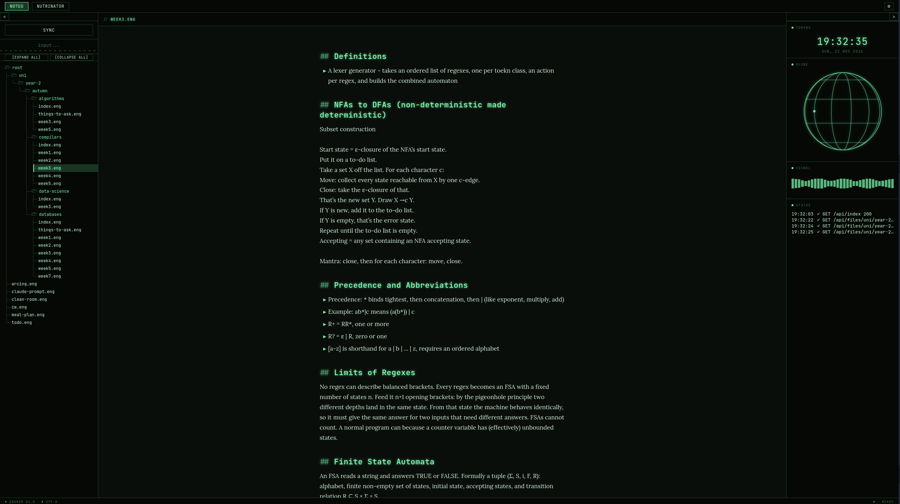

# Engram

A self-hosted reader for my notes. Notes are written as plain-text `.eng` files in [BMD](https://github.com/szewczyk-bartosz/engramware), rendered to HTML on the server, and browsed through a React front end with a file tree, search, maths and syntax highlighting.



## How it works


notesDir/*.eng -> index.py -> creates index and renders notes to HTML

caddy serves the static react build over tailscale (making it secure without a login page), which hits up server.py api endpoints for rendered files 

Those rendered files are then injected into the reading view


| Part | What it does |
| --- | --- |
| `server/index.py` | Walks the notes directory, builds a JSON tree of files and folders, and calls `bmd` only on files whose SHA-256 hash has changed. Failed renders are reported and retried on the next sync. |
| `server/server.py` | Small standard-library HTTP API: `GET /api/index`, `GET /api/files/<path>`, `POST /api/sync`.
| `src/` | React and TypeScript front end built with Vite. KaTeX and Prism for math and code
| `flake.nix` | Dev shell, a package for the static build, and a NixOS module that runs the API under systemd and serves everything through Caddy. |

## Security notes

- The front end always shares the API's origin, so no CORS headers are sent and other sites can't read notes from it.
- File paths are resolved and checked to stay inside the rendered directory, so `../` requests are rejected.
- The systemd unit runs with `ProtectSystem=strict`, `PrivateTmp`, `NoNewPrivileges` and read-only access to the notes.

## Running it

With Nix, run `nix develop` (or let direnv load it), then `start-engram`. That opens a tmux window with Vite on `localhost:8080` and the API on `localhost:8001`.

Without Nix you need Node, pnpm, Python 3 and `bmd` on your `PATH`:

```sh
pnpm install && pnpm dev
python3 server/server.py -i ./my-notes --web-root .
```

Press **Sync** in the file tree to render the notes.

On NixOS, import `engram.nixosModules.default` and set:

```nix
services.engram = {
  enable = true;
  notesDir = "/home/alice/notes";
  webRoot = "/var/lib/engram";
  user = "alice";
};
```
